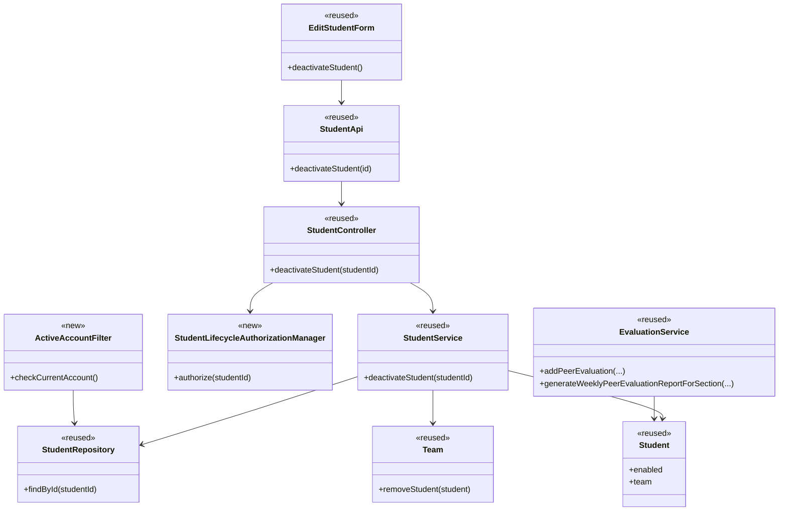
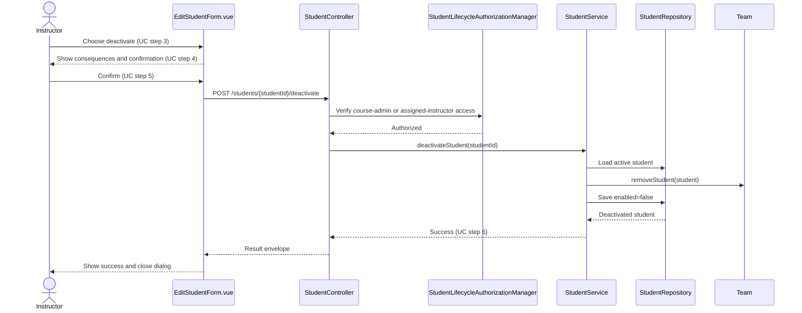
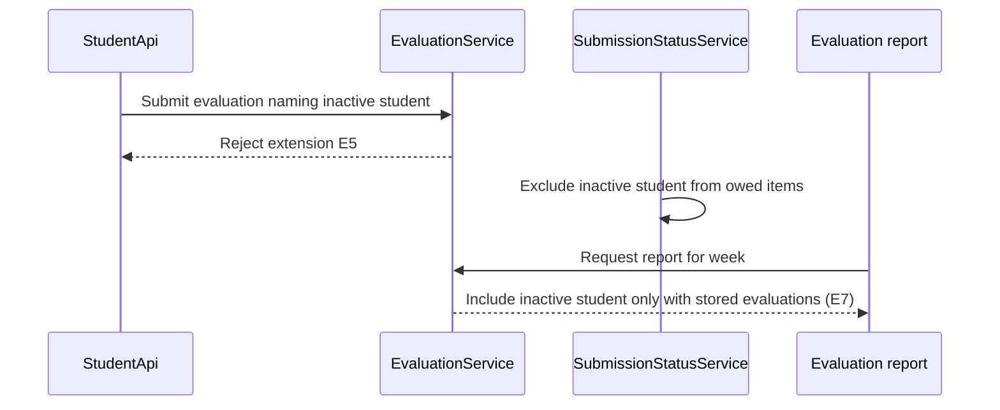
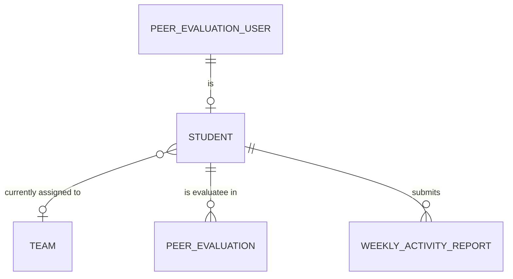

# **Student Design**

> Realizes: UC-STU-deactivate-student
> Depends on FRs: FR-SEC-authorization, FR-SEC-deny-unauthorized, FR-SEC-active-account
> See: [Use Cases](../requirements/use-cases.md), [Business Rules](../requirements/business-rules.md), [Software Requirements Specification](../requirements/software-requirements-specification.md), and [Architectural Design](architectural-design.md)

## **Overview**

Student lifecycle actions remain in the shared foundation `student` bounded context. Deactivation is a dedicated command that preserves the student and her records, removes her current team assignment, and is guarded by both the security route rule and the service lifecycle check. The implementation uses the existing user, team, evaluation, notification, and JWT infrastructure rather than introducing a parallel lifecycle model.

## **Components & classes**

- Reused and extended backend slice: `backend/src/main/java/team/projectpulse/student/StudentController.java`, `StudentService.java`, `StudentRepository.java`, `Student.java`, and `team/Team.java`.
- New backend security components: `security/authorizationmanagers/StudentLifecycleAuthorizationManager.java` and the active-account request check under `security/`.
- Reused and extended evaluation behavior: `backend/src/main/java/team/projectpulse/evaluation/EvaluationService.java`.
- Reused and extended frontend files: `frontend/src/pages/students/EditStudentForm.vue` and `frontend/src/apis/student/index.ts`.

## **Sequence**

### **Deactivation**

### **Lifecycle and historical-record boundaries**

## **API contract**

| Endpoint or job | Caller (who may) | Request | Success | Errors, by extension |
|---|---|---|---|---|
| `POST /students/{studentId}/deactivate` | Course admin or instructor assigned to the student's course section | Student ID in the path; no request body | `Result` containing the deactivated student DTO | E1 lifecycle error when already inactive; E2 `403` for an unauthorized instructor; missing authorized student maps to the standard not-found error |
| Protected API request after deactivation | Authenticated account | Existing request and JWT | Existing endpoint response for active callers | E6 `401`/access denial for a deactivated account, including an already-issued token |

## **Key decisions**

- **Dedicated lifecycle command:** Use a dedicated endpoint rather than the generic student update. The generic update was rejected because it permits silent status changes mixed with profile edits and cannot express the confirmation boundary.
- **Remove current team assignment:** Clear the team association while preserving the student and all records. Retaining the association was rejected because current-team calculations would continue to treat an inactive student as a teammate; automatic reassignment on reactivation was also rejected because it would restore current membership without an explicit course-admin action.
- **Preserve historical evaluations:** Reject new evaluations of inactive students while retaining stored evaluations and exposing them only in weeks where they exist. Deleting or globally hiding them was rejected because submitted peer evaluations are part of the team record.
- **Immediate account enforcement:** Re-check the persisted account status for protected requests instead of relying only on login-time authentication. Login-only enforcement was rejected because a valid JWT otherwise remains usable until expiry and violates `FR-SEC-active-account`.
- **Authorization at the route and lifecycle service:** Add a domain-aware route rule and repeat the active-state transition check in the service. A role-only route was rejected because instructor assignment to the student's course section is required by `BR-student-lifecycle` and `BR-section-scoped-access`.

## **Data model**

No schema delta is required. The design uses the existing `PeerEvaluationUser.enabled` field and nullable `Student.team` association; peer-evaluation rows are unchanged.

The shared entities and their ownership remain defined by the SRS Business Domain Model; this diagram shows only the lifecycle-relevant delta.

## **Reuse & cross-cutting**

- Reuse `FR-SEC-authorization`, `BR-role-based-access`, and `BR-section-scoped-access` through the security filter chain and domain authorization manager.
- Reuse `FR-SEC-active-account` through request authentication enforcement and the existing `UserService`/`MyUserPrincipal` enabled state.
- Reuse `BR-submission-owed` and `SubmissionStatusService` so inactive students receive no weekly reminders.
- Reuse existing `Team.removeStudent` and evaluation persistence so historical work is not deleted.
- No locking, collaboration, validation, email, migration, or new notification subsystem is introduced.

## **Tests**

| Use case, flow | Level (unit / integration) | Asserts |
|---|---|---|
| UC-STU-deactivate-student main success | Integration | Authorized instructor deactivates an active student; `enabled` becomes false, team membership is cleared, and submitted records remain |
| E1 already inactive | Unit and integration | The lifecycle transition is rejected and no state changes |
| E2 unauthorized instructor | Integration | An instructor outside the student's course section receives `403` |
| E3 confirmation cancellation | Frontend/component | Cancel performs no API call and leaves the student unchanged |
| E4 current team assignment | Unit and integration | Confirmation removes the team association without deleting the student or her records |
| E5 new evaluation of inactive student | Unit and integration | The evaluation is rejected while existing evaluations remain |
| E6 already-issued JWT | Security integration | A token issued before deactivation cannot access a protected endpoint afterward |
| E7 historical report | Unit and integration | Reports include the inactive student only in weeks with stored evaluations |
| Reactivation constraint | Unit | Reactivation does not restore a team assignment removed during deactivation |

## **Open questions / risks**

- The existing authentication architecture has no token revocation list; immediate enforcement requires a persisted account lookup on protected requests or an equivalent security integration point. This adds request-time database work but is required by `FR-SEC-active-account`.
- The existing peer-evaluation report currently creates entries for every team member, so its filtering must distinguish historical evaluations from an empty current report entry.
- `UC-STU-reactivate-student` remains out of scope; its Associated Information now records the no-automatic-team-restoration constraint.
